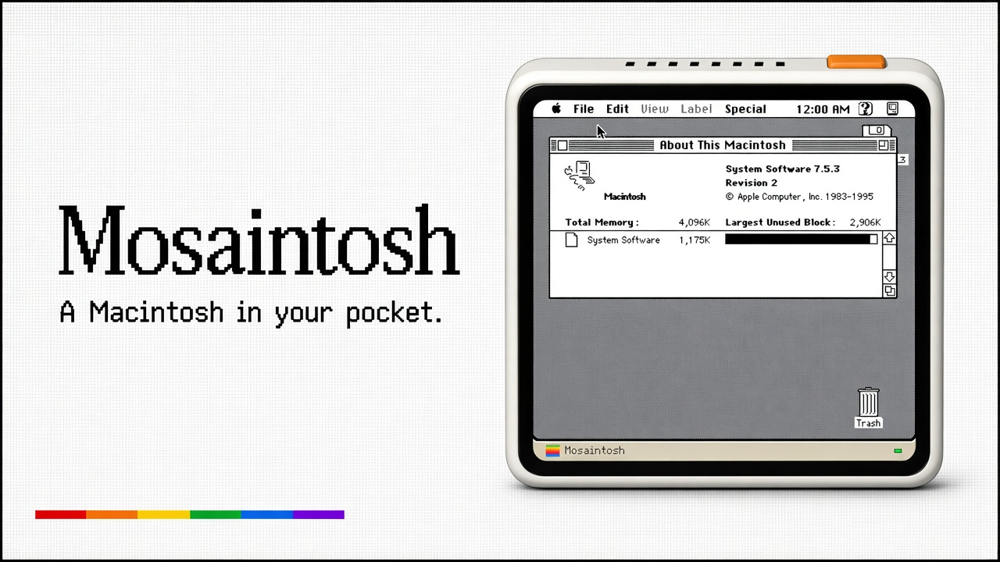
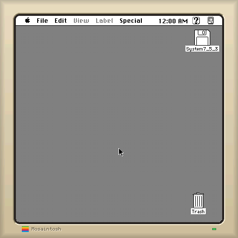
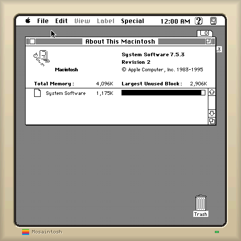

<div align="center">



# Mosaintosh

**A Macintosh in your pocket.**

在 ESP-Mosaico 上运行真正的 Macintosh Plus ROM 与 System 7.5.3。

[项目主页](https://hkgood.github.io/Mosaintosh/) · [第三方许可](THIRD_PARTY.md)

</div>

---

Mosaintosh 把一台 4 MB Macintosh Plus 搬到 ESP32-S31：480×480 CO5300
触摸屏显示 416×416 的 1-bit Mac 桌面，手指直接作为鼠标。模拟器基于
[umac](https://github.com/evansm7/umac)，68000 CPU 核心来自 Musashi。

<p align="center">
  
  
</p>

## 特性

- 真正的 Mac Plus v3 ROM 与 System Software 7.5.3，不是仿制界面。
- 4 MB Mac 内存，System 7 以 1.00× 实时速度运行。
- 416×416 显示区域完整避开 ESP-Mosaico 圆角，并保留菜单栏与桌面四角。
- 触摸映射为绝对定位鼠标；边框触摸自动贴到最近的 Mac 屏幕边缘。
- 逐行比较 1-bit 帧缓冲，只把变化区域转换为 RGB565 并推送到面板。
- 启动盘从只读 flash 映射；运行时写入进入 2 MB PSRAM 写时复制层，重启即清空。
- 同一份固件源码可在 macOS 板级模拟器中启动、交互并逐像素验证。

## ROM 与系统盘

仓库不包含、也不会分发 Apple ROM 或系统软件。请使用你合法拥有的镜像，并放入
已被 Git 忽略的 `assets/`：

```text
assets/MacPlus-v3.rom   128 KB Mac Plus v3 ROM，校验和 4D1F8172
assets/System.img       可启动的原始 HFS 卷，System 7.5.3
```

## 在 macOS 上验证

首次裁剪系统盘需要 Python 的 `machfs`：

```sh
python3 -m venv build/venv
build/venv/bin/pip install machfs

make disk          # 生成并启动验证 10/8/6 MB 三种系统盘
make board         # 启动到 Finder，触摸打开“About This Macintosh”
make board-window  # 打开交互式 Cocoa 窗口，鼠标模拟触摸
make boot          # 纯主机启动，每 5 秒保存一张截图
```

`sim/board` 模拟 ESP-IDF、FreeRTOS、CO5300 异步传输、CST9220 触摸和只读 flash
分区。`make board` 会把每次面板刷新与 Mac 帧缓冲逐像素对照。

最新验证结果：

```text
System Software 7.5.3 启动成功
4861 个时序钩子通过
238 次面板传输，0 errors，0 warnings
主任务栈峰值 3776 / 20480 bytes
```

## 构建 ESP-Mosaico 固件

ESP-IDF 包装工程位于 `esp-mosaico-vibe/projects/mosaintosh`。在 Vibe 工作区执行：

```sh
python mosaico.py iris system-update --project projects/mosaintosh
```

首次安装或分区资源变化时使用 `system-update`。只有应用代码变化且分区表与 ROM/磁盘
资源完全相同时，才使用 `iris app-update`。

生成的系统更新包包含应用、分区表、128 KB ROM 分区和 8 MB 启动盘分区。本地最新构建
产物为 `mosaintosh-system-update.irisfw`。

## 目录

```text
main/          ESP32-S31 固件：显示、触摸、磁盘与模拟器入口
host/          headless、自动板级检查和 Cocoa 交互窗口
sim/board/     ESP-Mosaico / ESP-IDF / FreeRTOS 主机模拟层
external/umac/ Macintosh Plus 模拟器与 Musashi 68000 核心
tools/         系统盘裁剪与截图转换
docs/          GitHub Pages
```

## 许可

Mosaintosh 使用 GPL-3.0-or-later。第三方组件及其许可证见
[THIRD_PARTY.md](THIRD_PARTY.md)。

Macintosh、Mac、System 7 与 Apple 是 Apple Inc. 的商标。本项目与 Apple Inc.
无关联，不提供任何 Apple ROM 或系统软件。
